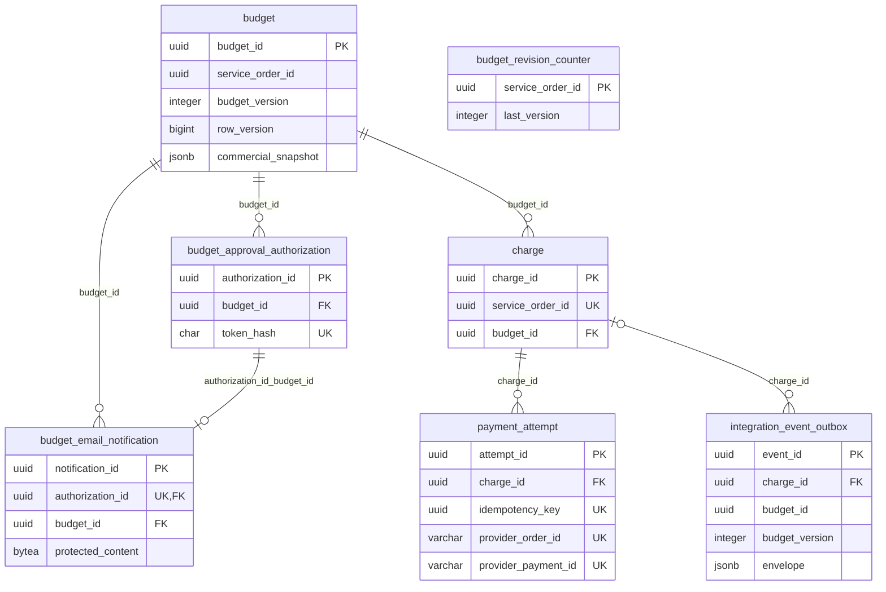

# Modelo de dados PostgreSQL

Esquema resultante da aplicação de V1 a V12 em ordem numérica, conferido em PostgreSQL 17 descartável. Flyway aplica as migrations de [db/migration](../../src/main/resources/db/migration); Hibernate usa `ddl-auto=validate`, sem criar o esquema. As sete tabelas abaixo são da aplicação; a tabela de controle `flyway_schema_history` é gerenciada pelo Flyway e não integra o modelo de negócio.

## Relações

O diagrama mostra somente FKs físicas. `service_order_id` e os IDs do snapshot são referências lógicas externas; não há tabela de OS/Inventory no Billing. `budget_revision_counter.service_order_id` não tem FK para `budget`. `integration_event_outbox.budget_id` também não tem FK, apesar da referência lógica. A cardinalidade do ERD representa o permitido pelas FKs; as regras comerciais impõem restrições adicionais.

## Dicionário de dados

`NULL = não` significa NOT NULL. `—` em default significa que o banco não fornece valor. `TIMESTAMP` é sem fuso; `TIMESTAMPTZ` é timestamp com fuso. `NUMERIC` não tem precisão/escala fixadas. PK implica NOT NULL e índice único. As FKs usam os comportamentos padrão PostgreSQL (`NO ACTION`, sem cascade), não são deferrable. Os nomes dos índices de PK/UNIQUE constam ao final.

### `budget`

Revisão comercial: identidade, valor, estado, snapshot e auditoria de aprovação. Datas comerciais usam TIMESTAMP sem fuso.

| Coluna | Tipo PostgreSQL | NULL | Default | Papel | Descrição |
| --- | --- | --- | --- | --- | --- |
| `budget_id` | UUID | não | — | PK | Identidade da revisão local |
| `service_order_id` | UUID | não | — | UNIQUE | Referência lógica à OS externa |
| `budget_version` | INTEGER | não | — | UNIQUE | Versão comercial por OS |
| `quoted_amount` | NUMERIC | não | — | — | Valor proposto |
| `approved_amount` | NUMERIC | sim | — | — | Valor integral aprovado, quando existente |
| `status` | VARCHAR(20) | não | — | — | Estado conforme os checks desta tabela |
| `sent_at` | TIMESTAMP | sim | — | — | Data do envio comercial ou do aceite SMTP, conforme tabela |
| `approved_at` | TIMESTAMP | sim | — | — | Data da aprovação |
| `created_at` | TIMESTAMP | não | — | — | Criação do registro |
| `updated_at` | TIMESTAMP | sim | — | — | Última alteração local |
| `commercial_snapshot` | JSONB | sim | — | — | Composição registrada em JSONB |
| `row_version` | BIGINT | não | `0` | — | Versão técnica JPA |
| `approval_origin` | VARCHAR(20) | sim | — | — | Origem da aprovação: IN_PERSON ou REMOTE; legado pode ser nulo |
| `approved_by_employee_id` | VARCHAR(255) | sim | — | — | Contexto de auditoria presencial |

Restrições físicas (definições do catálogo após V12):

- `budget_pkey`: `PRIMARY KEY (budget_id)`.
- `ck_budget_approval_audit`: `CHECK ((((approval_origin IS NULL) AND (approved_by_employee_id IS NULL)) OR (((status)::text = 'APPROVED'::text) AND (approval_origin IS NOT NULL) AND ((approval_origin)::text = 'IN_PERSON'::text) AND (approved_by_employee_id IS NOT NULL) AND (length(btrim((approved_by_employee_id)::text)) > 0)) OR (((status)::text = 'APPROVED'::text) AND (approval_origin IS NOT NULL) AND ((approval_origin)::text = 'REMOTE'::text) AND (approved_by_employee_id IS NULL))))`.
- `ck_budget_status`: `CHECK (((status)::text = ANY ((ARRAY['DRAFT'::character varying, 'SENT'::character varying, 'APPROVED'::character varying, 'REJECTED'::character varying, 'CANCELLED'::character varying])::text[])))`.
- `ck_budget_version_positive`: `CHECK ((budget_version > 0))`.
- `uk_budget_service_order_version`: `UNIQUE (service_order_id, budget_version)`.

### `budget_revision_counter`

Uma linha por OS com a última versão atribuída. Também é a linha estável de serialização das transições Budget.

| Coluna | Tipo PostgreSQL | NULL | Default | Papel | Descrição |
| --- | --- | --- | --- | --- | --- |
| `service_order_id` | UUID | não | — | PK | Referência lógica à OS externa |
| `last_version` | INTEGER | não | — | — | Última versão comercial atribuída |

Restrições físicas (definições do catálogo após V12):

- `budget_revision_counter_pkey`: `PRIMARY KEY (service_order_id)`.
- `ck_budget_revision_counter_positive`: `CHECK ((last_version > 0))`.

### `budget_approval_authorization`

Autorização pública por hash SHA-256, vinculada a uma revisão, com validade, revogação e consumo.

| Coluna | Tipo PostgreSQL | NULL | Default | Papel | Descrição |
| --- | --- | --- | --- | --- | --- |
| `authorization_id` | UUID | não | — | PK, UNIQUE | Identidade da autorização pública |
| `budget_id` | UUID | não | — | FK, UNIQUE | Identidade da revisão local |
| `token_hash` | CHAR(64) | não | — | UNIQUE | SHA-256 hexadecimal do token; não contém o token original |
| `created_at` | TIMESTAMPTZ | não | `CURRENT_TIMESTAMP` | — | Criação do registro |
| `expires_at` | TIMESTAMPTZ | não | — | — | Fim exclusivo da validade |
| `revoked_at` | TIMESTAMPTZ | sim | — | — | Revogação de autorização não consumida |
| `consumed_at` | TIMESTAMPTZ | sim | — | — | Consumo único da decisão pública |

Restrições físicas (definições do catálogo após V12):

- `budget_approval_authorization_budget_id_fkey`: `FOREIGN KEY (budget_id) REFERENCES budget(budget_id)`.
- `budget_approval_authorization_pkey`: `PRIMARY KEY (authorization_id)`.
- `budget_approval_authorization_token_hash_key`: `UNIQUE (token_hash)`.
- `ck_authorization_consumption`: `CHECK (((consumed_at IS NULL) OR ((revoked_at IS NULL) AND (consumed_at >= created_at) AND (consumed_at < expires_at))))`.
- `ck_authorization_expiry`: `CHECK ((expires_at > created_at))`.
- `uk_authorization_budget`: `UNIQUE (authorization_id, budget_id)`.

### `budget_email_notification`

Intenção de entrega SMTP, conteúdo cifrado e estado operacional. Uma solicitação por autorização; reenvio cria outra autorização/solicitação.

| Coluna | Tipo PostgreSQL | NULL | Default | Papel | Descrição |
| --- | --- | --- | --- | --- | --- |
| `notification_id` | UUID | não | — | PK | Identidade da solicitação SMTP |
| `authorization_id` | UUID | não | — | UNIQUE, FK | Identidade da autorização pública |
| `budget_id` | UUID | não | — | FK | Identidade da revisão local |
| `protected_content` | BYTEA | sim | — | — | Destinatário e link cifrados com AES-256-GCM; apagados no estado final |
| `status` | VARCHAR(20) | não | `'PENDING'::character varying` | — | Estado conforme os checks desta tabela |
| `created_at` | TIMESTAMPTZ | não | `CURRENT_TIMESTAMP` | — | Criação do registro |
| `sent_at` | TIMESTAMPTZ | sim | — | — | Data do envio comercial ou do aceite SMTP, conforme tabela |
| `attempt_count` | INTEGER | não | `0` | — | Número de reivindicações, inclusive interrompidas |
| `last_attempt_at` | TIMESTAMPTZ | sim | — | — | Última reivindicação de envio |
| `next_attempt_at` | TIMESTAMPTZ | não | `CURRENT_TIMESTAMP` | — | Disponibilidade da próxima tentativa |
| `last_error` | VARCHAR(60) | sim | — | — | Categoria controlada da falha |
| `lease_token` | UUID | sim | — | — | Identidade da posse temporária do worker |
| `lease_until` | TIMESTAMPTZ | sim | — | — | Fim da posse temporária |

Restrições físicas (definições do catálogo após V12):

- `budget_email_notification_authorization_id_key`: `UNIQUE (authorization_id)`.
- `budget_email_notification_budget_id_fkey`: `FOREIGN KEY (budget_id) REFERENCES budget(budget_id)`.
- `budget_email_notification_pkey`: `PRIMARY KEY (notification_id)`.
- `ck_notification_attempts`: `CHECK ((attempt_count >= 0))`.
- `ck_notification_content`: `CHECK ((((status)::text <> 'PENDING'::text) OR (protected_content IS NOT NULL)))`.
- `ck_notification_lease`: `CHECK (((lease_token IS NULL) = (lease_until IS NULL)))`.
- `ck_notification_status`: `CHECK (((status)::text = ANY ((ARRAY['PENDING'::character varying, 'SENT'::character varying, 'FAILED'::character varying, 'CANCELLED'::character varying])::text[])))`.
- `fk_notification_authorization_budget`: `FOREIGN KEY (authorization_id, budget_id) REFERENCES budget_approval_authorization(authorization_id, budget_id)`.

### `charge`

Cobrança única por OS, com valor e moeda preservados e referência física ao Budget.

| Coluna | Tipo PostgreSQL | NULL | Default | Papel | Descrição |
| --- | --- | --- | --- | --- | --- |
| `charge_id` | UUID | não | — | PK | Identidade da cobrança local |
| `service_order_id` | UUID | não | — | UNIQUE | Referência lógica à OS externa |
| `budget_id` | UUID | não | — | FK | Identidade da revisão local |
| `amount` | NUMERIC | não | — | — | Valor comercial da cobrança |
| `currency` | VARCHAR(3) | não | — | — | Código da moeda da cobrança |
| `status` | VARCHAR(10) | não | — | — | Estado conforme os checks desta tabela |
| `created_at` | TIMESTAMPTZ | não | — | — | Criação do registro |
| `updated_at` | TIMESTAMPTZ | não | — | — | Última alteração local |
| `row_version` | BIGINT | não | `0` | — | Versão técnica JPA |

Restrições físicas (definições do catálogo após V12):

- `charge_pkey`: `PRIMARY KEY (charge_id)`.
- `ck_charge_amount`: `CHECK (((amount > (0)::numeric) AND (amount < 'Infinity'::numeric)))`.
- `ck_charge_currency`: `CHECK (((currency)::text ~ '^[A-Z]{3}$'::text))`.
- `ck_charge_dates`: `CHECK ((updated_at >= created_at))`.
- `ck_charge_row_version`: `CHECK ((row_version >= 0))`.
- `ck_charge_status`: `CHECK (((status)::text = ANY ((ARRAY['OPEN'::character varying, 'PAID'::character varying])::text[])))`.
- `fk_charge_budget`: `FOREIGN KEY (budget_id) REFERENCES budget(budget_id)`.
- `uk_charge_service_order`: `UNIQUE (service_order_id)`.

### `payment_attempt`

Histórico financeiro e de checkout da cobrança. Método anulável desde V10; reserva permanente desde V11.

| Coluna | Tipo PostgreSQL | NULL | Default | Papel | Descrição |
| --- | --- | --- | --- | --- | --- |
| `attempt_id` | UUID | não | — | PK | Identidade da tentativa |
| `charge_id` | UUID | não | — | FK | Identidade da cobrança local |
| `payment_method` | VARCHAR(10) | sim | — | — | PIX ou CARD, se conhecido |
| `status` | VARCHAR(10) | não | — | — | Estado conforme os checks desta tabela |
| `idempotency_key` | UUID | não | — | UNIQUE | Chave UUID global da tentativa |
| `provider_payment_id` | VARCHAR(255) | sim | — | UNIQUE | Identidade da transação financeira no provedor |
| `created_at` | TIMESTAMPTZ | não | — | — | Criação do registro |
| `updated_at` | TIMESTAMPTZ | não | — | — | Última alteração local |
| `provider_order_id` | VARCHAR(255) | sim | — | UNIQUE | Identidade da order de checkout no provedor |
| `checkout_url` | VARCHAR(2048) | sim | — | — | URL HTTPS de checkout validada |
| `checkout_creation_claimed_at` | TIMESTAMPTZ | sim | — | — | Reserva de criação permanente; não é prazo de posse |

Restrições físicas (definições do catálogo após V12):

- `ck_payment_attempt_checkout_claim_time`: `CHECK (((checkout_creation_claimed_at IS NULL) OR ((checkout_creation_claimed_at >= created_at) AND (checkout_creation_claimed_at <= updated_at))))`.
- `ck_payment_attempt_checkout_url`: `CHECK (((checkout_url IS NULL) OR ((provider_order_id IS NOT NULL) AND ((checkout_url)::text ~* '^https://[^/?#[:space:]@]+([/?][^#[:space:]]*)?$'::text) AND ((checkout_url)::text !~ '[[:cntrl:]]'::text))))`.
- `ck_payment_attempt_dates`: `CHECK ((updated_at >= created_at))`.
- `ck_payment_attempt_method`: `CHECK (((payment_method)::text = ANY ((ARRAY['PIX'::character varying, 'CARD'::character varying])::text[])))`.
- `ck_payment_attempt_paid`: `CHECK ((((status)::text <> 'PAID'::text) OR (provider_payment_id IS NOT NULL)))`.
- `ck_payment_attempt_provider_order`: `CHECK (((provider_order_id IS NULL) OR ((length(btrim((provider_order_id)::text)) > 0) AND ((provider_order_id)::text = btrim((provider_order_id)::text)) AND ((provider_order_id)::text !~ '[[:cntrl:]]'::text))))`.
- `ck_payment_attempt_provider_payment`: `CHECK (((provider_payment_id IS NULL) OR ((length(btrim((provider_payment_id)::text)) > 0) AND ((provider_payment_id)::text = btrim((provider_payment_id)::text)) AND ((provider_payment_id)::text !~ '[[:cntrl:]]'::text))))`.
- `ck_payment_attempt_status`: `CHECK (((status)::text = ANY ((ARRAY['PENDING'::character varying, 'UNKNOWN'::character varying, 'PAID'::character varying, 'FAILED'::character varying, 'EXPIRED'::character varying])::text[])))`.
- `fk_payment_attempt_charge`: `FOREIGN KEY (charge_id) REFERENCES charge(charge_id)`.
- `payment_attempt_pkey`: `PRIMARY KEY (attempt_id)`.
- `uk_payment_attempt_idempotency`: `UNIQUE (idempotency_key)`.
- `uk_payment_attempt_provider_order`: `UNIQUE (provider_order_id)`.
- `uk_payment_attempt_provider_payment`: `UNIQUE (provider_payment_id)`.

### `integration_event_outbox`

Envelope imutável pelo repositório, estado de publicação e posse. V12 acrescenta referência financeira opcional para a primeira quitação.

| Coluna | Tipo PostgreSQL | NULL | Default | Papel | Descrição |
| --- | --- | --- | --- | --- | --- |
| `event_id` | UUID | não | — | PK | Identidade estável do evento |
| `event_type` | VARCHAR(100) | não | — | UNIQUE | Nome do fato comercial |
| `schema_version` | INTEGER | não | — | — | Versão do contrato do envelope |
| `service_order_id` | UUID | não | — | — | Referência lógica à OS externa |
| `budget_id` | UUID | sim | — | UNIQUE | Identidade da revisão local |
| `budget_version` | INTEGER | sim | — | — | Versão comercial por OS |
| `envelope` | JSONB | não | — | — | Objeto JSON completo enviado como corpo SQS |
| `status` | VARCHAR(20) | não | `'PENDING'::character varying` | — | Estado conforme os checks desta tabela |
| `created_at` | TIMESTAMPTZ | não | `CURRENT_TIMESTAMP` | — | Criação do registro |
| `published_at` | TIMESTAMPTZ | sim | — | — | Confirmação local do aceite SQS |
| `attempt_count` | INTEGER | não | `0` | — | Número de reivindicações, inclusive interrompidas |
| `next_attempt_at` | TIMESTAMPTZ | não | `CURRENT_TIMESTAMP` | — | Disponibilidade da próxima tentativa |
| `last_error` | TEXT | sim | — | — | Categoria controlada da falha |
| `lease_token` | UUID | sim | — | — | Identidade da posse temporária do worker |
| `lease_until` | TIMESTAMPTZ | sim | — | — | Fim da posse temporária |
| `charge_id` | UUID | sim | — | FK | Identidade da cobrança local |

Restrições físicas (definições do catálogo após V12):

- `ck_outbox_attempt_count`: `CHECK ((attempt_count >= 0))`.
- `ck_outbox_budget_reference`: `CHECK ((((budget_id IS NULL) AND (budget_version IS NULL)) OR ((budget_id IS NOT NULL) AND (budget_version IS NOT NULL) AND (budget_version > 0))))`.
- `ck_outbox_envelope_object`: `CHECK ((jsonb_typeof(envelope) = 'object'::text))`.
- `ck_outbox_payment_reference`: `CHECK ((((charge_id IS NULL) AND ((event_type)::text <> 'PagamentoConfirmado'::text)) OR ((charge_id IS NOT NULL) AND ((event_type)::text = 'PagamentoConfirmado'::text) AND (budget_id IS NULL) AND (budget_version IS NULL))))`.
- `ck_outbox_schema_version_positive`: `CHECK ((schema_version > 0))`.
- `ck_outbox_status`: `CHECK (((status)::text = ANY ((ARRAY['PENDING'::character varying, 'PUBLISHED'::character varying, 'NEEDS_REVIEW'::character varying])::text[])))`.
- `fk_outbox_charge`: `FOREIGN KEY (charge_id) REFERENCES charge(charge_id)`.
- `integration_event_outbox_pkey`: `PRIMARY KEY (event_id)`.
- `uk_outbox_budget_event`: `UNIQUE (budget_id, event_type)`.

## Índices finais

Inclui os índices de PK/UNIQUE criados implicitamente e os índices declarados nas migrations. UNIQUE com colunas anuláveis admite múltiplos NULLs, salvo se outro check/índice restringir o caso. Nenhum índice parcial de autorização verifica o relógio: uma autorização expirada ainda ocupa a posição até revogação/consumo.

| Tabela | Índice | Definição |
| --- | --- | --- |
| `budget` | `budget_pkey` | `CREATE UNIQUE INDEX budget_pkey ON public.budget USING btree (budget_id)` |
| `budget` | `uk_budget_service_order_version` | `CREATE UNIQUE INDEX uk_budget_service_order_version ON public.budget USING btree (service_order_id, budget_version)` |
| `budget_approval_authorization` | `budget_approval_authorization_pkey` | `CREATE UNIQUE INDEX budget_approval_authorization_pkey ON public.budget_approval_authorization USING btree (authorization_id)` |
| `budget_approval_authorization` | `budget_approval_authorization_token_hash_key` | `CREATE UNIQUE INDEX budget_approval_authorization_token_hash_key ON public.budget_approval_authorization USING btree (token_hash)` |
| `budget_approval_authorization` | `uk_authorization_budget` | `CREATE UNIQUE INDEX uk_authorization_budget ON public.budget_approval_authorization USING btree (authorization_id, budget_id)` |
| `budget_approval_authorization` | `uk_budget_active_authorization` | `CREATE UNIQUE INDEX uk_budget_active_authorization ON public.budget_approval_authorization USING btree (budget_id) WHERE ((revoked_at IS NULL) AND (consumed_at IS NULL))` |
| `budget_email_notification` | `budget_email_notification_authorization_id_key` | `CREATE UNIQUE INDEX budget_email_notification_authorization_id_key ON public.budget_email_notification USING btree (authorization_id)` |
| `budget_email_notification` | `budget_email_notification_pkey` | `CREATE UNIQUE INDEX budget_email_notification_pkey ON public.budget_email_notification USING btree (notification_id)` |
| `budget_email_notification` | `idx_budget_notification_latest` | `CREATE INDEX idx_budget_notification_latest ON public.budget_email_notification USING btree (budget_id, created_at DESC, notification_id DESC)` |
| `budget_email_notification` | `idx_budget_notification_pending` | `CREATE INDEX idx_budget_notification_pending ON public.budget_email_notification USING btree (next_attempt_at, created_at, notification_id) WHERE ((status)::text = 'PENDING'::text)` |
| `budget_revision_counter` | `budget_revision_counter_pkey` | `CREATE UNIQUE INDEX budget_revision_counter_pkey ON public.budget_revision_counter USING btree (service_order_id)` |
| `charge` | `charge_pkey` | `CREATE UNIQUE INDEX charge_pkey ON public.charge USING btree (charge_id)` |
| `charge` | `ix_charge_budget` | `CREATE INDEX ix_charge_budget ON public.charge USING btree (budget_id)` |
| `charge` | `uk_charge_service_order` | `CREATE UNIQUE INDEX uk_charge_service_order ON public.charge USING btree (service_order_id)` |
| `integration_event_outbox` | `idx_outbox_pending` | `CREATE INDEX idx_outbox_pending ON public.integration_event_outbox USING btree (next_attempt_at, created_at, event_id) WHERE ((status)::text = 'PENDING'::text)` |
| `integration_event_outbox` | `integration_event_outbox_pkey` | `CREATE UNIQUE INDEX integration_event_outbox_pkey ON public.integration_event_outbox USING btree (event_id)` |
| `integration_event_outbox` | `uk_outbox_budget_event` | `CREATE UNIQUE INDEX uk_outbox_budget_event ON public.integration_event_outbox USING btree (budget_id, event_type)` |
| `integration_event_outbox` | `uk_outbox_charge_confirmation` | `CREATE UNIQUE INDEX uk_outbox_charge_confirmation ON public.integration_event_outbox USING btree (charge_id, event_type) WHERE (charge_id IS NOT NULL)` |
| `payment_attempt` | `ix_payment_attempt_charge_history` | `CREATE INDEX ix_payment_attempt_charge_history ON public.payment_attempt USING btree (charge_id, created_at, attempt_id)` |
| `payment_attempt` | `payment_attempt_pkey` | `CREATE UNIQUE INDEX payment_attempt_pkey ON public.payment_attempt USING btree (attempt_id)` |
| `payment_attempt` | `uk_payment_attempt_blocking_charge` | `CREATE UNIQUE INDEX uk_payment_attempt_blocking_charge ON public.payment_attempt USING btree (charge_id) WHERE ((status)::text = ANY ((ARRAY['PENDING'::character varying, 'UNKNOWN'::character varying, 'PAID'::character varying])::text[]))` |
| `payment_attempt` | `uk_payment_attempt_idempotency` | `CREATE UNIQUE INDEX uk_payment_attempt_idempotency ON public.payment_attempt USING btree (idempotency_key)` |
| `payment_attempt` | `uk_payment_attempt_provider_order` | `CREATE UNIQUE INDEX uk_payment_attempt_provider_order ON public.payment_attempt USING btree (provider_order_id)` |
| `payment_attempt` | `uk_payment_attempt_provider_payment` | `CREATE UNIQUE INDEX uk_payment_attempt_provider_payment ON public.payment_attempt USING btree (provider_payment_id)` |

## Integridade persistida e validações da aplicação

- `(service_order_id, budget_version)` é único. A aprovação única por OS é regra do gateway sob lock, não uma constraint de `budget`.
- A auditoria permite ambos os campos nulos (incluindo aprovação legada); IN_PERSON exige APPROVED e funcionário não vazio; REMOTE exige APPROVED e funcionário nulo.
- A FK composta da notificação garante autorização da mesma revisão. A autorização consumida não pode estar revogada e seu consumo deve ocorrer entre criação inclusiva e expiração exclusiva. O índice ativo exclui consumidas e revogadas.
- `ck_notification_content` exige cifra para PENDING; a remoção de conteúdo nos estados finais é comportamento do repositório, não imposição do check. A posse da notificação exige token e prazo simultaneamente nulos ou preenchidos. Não há check equivalente de par de posse na Outbox.
- `charge.budget_id` garante existência, mas não compara OS, estado aprovado, valor ou moeda. Essa comparação é feita pelo adaptador. A unicidade de cobrança por OS e o índice parcial de tentativa bloqueante impedem operações financeiras concorrentes válidas na mesma cobrança.
- O banco exige ID financeiro para tentativa PAID, mas não sincroniza automaticamente o estado da raiz Charge. Essa coerência é validada ao reconstruir o agregado e nas mutações pela raiz.
- V10 mantém os checks/índices V9, permite meio nulo e acrescenta order/URL. O check da URL impõe HTTPS e estrutura, mas a allowlist Mercado Pago pertence ao adaptador, não ao SQL.
- V12 exige `charge_id` para `PagamentoConfirmado` e elimina referências Budget desse registro; outros tipos não podem ter `charge_id`. O par `(charge_id, event_type)` é único quando charge_id existe. Os checks não validam a correspondência do JSON com todas as colunas nem impõem que event_type pertença à lista dos quatro eventos atuais.

## JPA, migrations e evolução

`BudgetEntity`, `ChargeEntity` e `PaymentAttemptEntity` correspondem às colunas finais, inclusive `payment_method` anulável e reserva. Os vínculos são UUIDs escalares, sem associações JPA: a ausência de `@ManyToOne` não elimina as FKs SQL. As outras quatro tabelas usam JDBC. Não foi identificada divergência de tipo/nulidade entre os mapeamentos inspecionados e as migrations; A correspondência foi conferida por leitura dos mapeamentos; isso não equivale à execução de Hibernate validate. A validação de JPA não substitui os checks e índices definidos no SQL.

V1 cria Budget; V2 cria e inicializa contadores por MAX existente; V3 adiciona snapshot; V4 adiciona versão técnica; V5 cria Outbox; V6 adiciona auditoria; V7 cria autorizações/notificações; V8 acrescenta consumo e substitui o índice ativo; V9 cria cobranças/tentativas; V10 adapta checkout; V11 adiciona reserva; V12 integra quitação à Outbox. V10 não normaliza históricos; V11 não assume reservas antigas; V12 não cria eventos retroativos para PAID histórico.

As principais diferenças entre domínio e SQL são intencionais ou débitos explícitos: `budget.quoted_amount` não impõe positividade/centavos, `charge` admite códigos monetários além de BRL e não restringe escala, e os checks não reproduzem todas as transições. Consulte [domínio](domain-model.md), [Outbox](../flows/outbox.md) e [débitos](../technical-debt.md).
