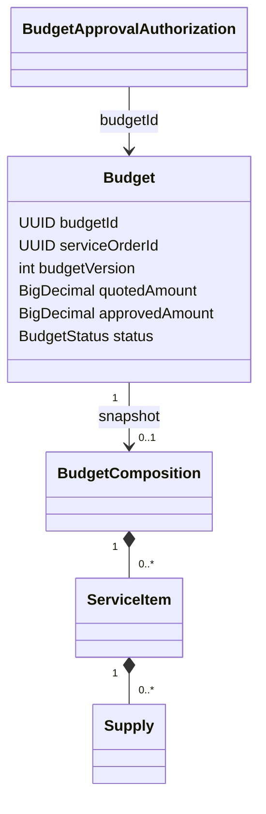
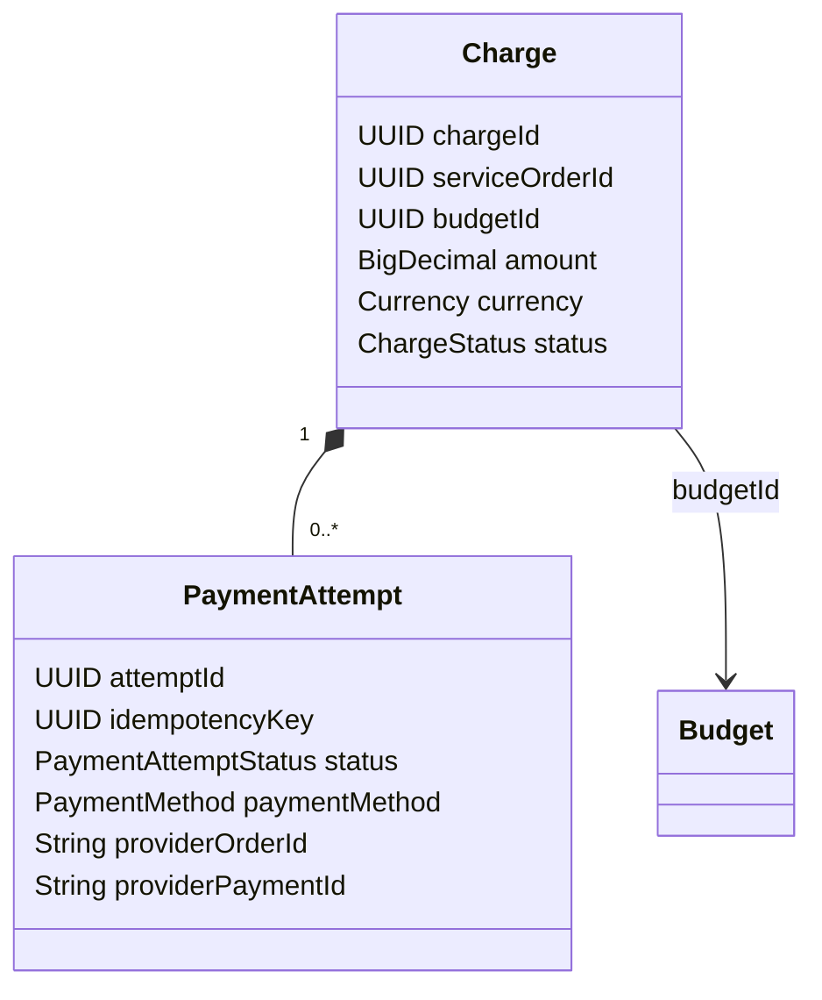

# Modelo de domínio

## Budget

`Budget` é a raiz que representa uma revisão comercial. Cada revisão tem `budgetId` próprio, referência externa `serviceOrderId`, `budgetVersion` crescente por OS, valor proposto, valor aprovado, estado e datas. Não existe entidade separada `BudgetRevision`.

`BudgetComposition` é um record imutável por valor, com listas copiadas, contendo os records `ServiceItem` e `Supply`. Os UUIDs de itens/serviços/insumos são referências aos serviços externos, não entidades locais. O snapshot mantém inclusive itens cancelados e campos não conhecidos no cálculo manual. Dados históricos podem ter composição nula.

`BudgetApprovalAuthorization`, no pacote `valueobjects`, é um record de autorização com identidade própria, hash, prazo, revogação e consumo. Não é outro agregado rico nem parte de uma coleção de `Budget`; a infraestrutura o persiste e coordena seu ciclo de vida. `ServiceOrderQuotationContext` e `InventoryItemPrice` são records de referência externa, não raízes locais. `BudgetEntity` é entidade JPA; `BudgetResponse` e os demais records de API são DTOs.

### Estados e invariantes

- `DRAFT → SENT → APPROVED` ou `REJECTED`. `CANCELLED` existe no enum/schema para leitura, sem comando de cancelamento.
- A aprovação é integral: `approvedAmount = quotedAmount`. Aprovação pública registra `REMOTE`; presencial registra `IN_PERSON` e funcionário. O PATCH administrativo legado mantém origem nula.
- A referência vigente é a maior `budgetVersion` entre `SENT`, `APPROVED` e `REJECTED`. Criar um DRAFT mais novo não invalida a revisão enviada; enviar a revisão mais nova impede decidir a antiga. Uma rejeição mais nova também impede reativar revisão anterior.
- Qualquer orçamento aprovado da OS bloqueia criar e enviar outra revisão pelo fluxo normal. Não há índice único parcial que imponha uma única aprovação: essa regra é aplicada sob lock pelo gateway.
- Criação e primeiro envio exigem contexto da OS em `IN_DIAGNOSIS` ou `REJECTED`. Reenvio exige SENT vigente e e-mail atual, sem repetir a guarda de status da OS.
- Valor manual deve ser positivo. O automático soma serviços elegíveis e preço × quantidade de insumos; ignora apenas itens `CANCELLED`. São elegíveis `PENDING`, `WAITING_FOR_PARTS_AND_SUPPLIES`, `IN_PROGRESS`, `COMPLETED`. Status ausente/desconhecido impede cálculo automático. Lista vazia produz zero, que Payment não aceita.
- A validação monetária usa `setScale(2, UNNECESSARY)` para detectar fração real de centavo. Aceita `1.23000` preservando a escala e rejeita `1.2301`, sem arredondar. Budget não possui moeda global nem valida positividade de cada preço/quantidade; `currency` dos insumos é informação do snapshot. Valor manual dispensa preços e elegibilidade individual dos itens.

O envio não recalcula o snapshot. Decisões repetidas com estado incompatível são recusadas; comandos Budget não oferecem chave idempotente HTTP. O contador transacional não consome versão em rollback e não é incrementado por envio/decisão. `row_version` é técnico, fica exclusivamente em JPA e não substitui `budgetVersion`.

### Casos de uso e portas

| Casos de uso | Responsabilidade |
| --- | --- |
| `CreateBudgetUseCase` | Validar valor manual, consultar OS e eventualmente Inventory, compor e criar DRAFT |
| `SendBudgetForApprovalUseCase` / `ResendBudgetApprovalUseCase` | Obter e-mail e solicitar envio/reenvio transacional |
| `ApproveBudgetUseCase` / `RejectBudgetUseCase` | Coordenar decisão administrativa legada |
| `RegisterBudgetApprovalUseCase` | Obter auditoria e validar OS para aprovação presencial de DRAFT |
| `GetBudgetUseCase` / `GetBudgetHistoryUseCase` | Detalhe com última notificação e histórico ordenado com referência |
| `GetBudgetApprovalPageUseCase` | Consultar revisão autorizada por token, sem consumi-lo |
| `ApproveBudgetRemotelyUseCase` / `RejectBudgetRemotelyUseCase` | Exigir confirmação explícita e decidir por token |

`BudgetGateway` é implementado por `BudgetGatewayImpl`; `BudgetNotificationGateway`, por `BudgetNotificationRepository`; `ServiceOrderGateway`/`InventoryGateway`, pelos adaptadores REST; `EmployeeIdentityGateway`, por `GatewayEmployeeIdentityAdapter`. `IntegrationEventPublicationGateway` é a porta de envio usada pelo worker SQS, implementada por `SqsIntegrationEventPublicationGateway`.

Criação e transições têm transação no gateway, com lock do contador por OS, releitura e flush da entidade gerenciada. O envio acrescenta autorização/notificação e Outbox na mesma transação; a decisão pública acrescenta consumo. I/O externo dos UseCases antecede essa transação e não é protegido contra mudança posterior na OS. Consulte o [fluxo completo](../flows/budget-approval.md).

Exceções de domínio relevantes: `InvalidBudgetDataException`, `BudgetCalculationException`, `InvalidBudgetStatusException`, `InvalidServiceOrderStatusException`, `IneligibleServiceOrderException`, `CustomerEmailException`, `ObsoleteBudgetRevisionException` e `ApprovedBudgetExistsException`. Os [contratos HTTP](../integrations/budget-http-contracts.md) descrevem a tradução dos erros da API/aplicação.

## Payment

`Charge` é a raiz; `PaymentAttempt` é entidade interna com identidade e histórico próprio. As mutações passam pela raiz. Não há entidade `Payment`, `PaymentProvider` ou `Payer` no domínio implementado, nem repositório de domínio independente para tentativas.

UUIDs, `BigDecimal` e `java.util.Currency` são tipos de valor utilizados diretamente. `ServiceOrderPaymentContext` é referência externa. `ProviderOrderSnapshot`, `ProviderPaymentSnapshot`, `OrderObservation`, `PreparedCheckout` e os resultados de checkout são dados de aplicação, não entidades persistentes. `ChargeEntity`/`PaymentAttemptEntity` são modelos JPA separados, mapeados por `ChargePersistenceMapper`.

### Invariantes e estados

| Elemento | Regra |
| --- | --- |
| Cobrança | `OPEN` ou `PAID`; uma cobrança por OS durante toda sua vida no MVP |
| Origem comercial | OS `COMPLETED` e Budget aprovado da mesma OS; valor lido localmente sob `FOR SHARE` |
| Novas operações | Valor positivo em BRL e centavos exatos, sem arredondamento; domínio preserva zeros finais excedentes |
| Tentativa | `PENDING`, `UNKNOWN`, `PAID`, `FAILED`, `EXPIRED`; as três primeiras bloqueiam nova tentativa |
| Idempotência | Chave UUID global por tentativa; replay retorna a entidade original antes de tentar criar outra |
| Identidades externas | Order e pagamento financeiro são distintos, opcionais até conhecidos e não substituíveis por valores divergentes; unicidade global no banco |
| Meio | `PIX`/`CARD`, inicialmente nulo, escolhido posteriormente no checkout; um meio conhecido não pode ser trocado |
| Reserva | `checkoutCreationClaimedAt` permanente; não é lease e nunca expira/libera por relógio |
| Quitação | `PAID` exige ID financeiro; raiz PAID equivale a exatamente uma tentativa paga |
| Datas | Atualização monotônica em microssegundos; mutação efetiva da tentativa altera a raiz; replay equivalente não altera versão/datas |

`PENDING` e `UNKNOWN` admitem resultados subsequentes. `PAID`, `FAILED` e `EXPIRED` são terminais para transições financeiras; metadados podem ser enriquecidos sem reabrir um resultado terminal. A primeira associação de order pode resolver UNKNOWN para PENDING; replay de metadados já equivalentes não desfaz UNKNOWN posterior.

A restauração mantém históricos compatíveis com as regras antigas de moeda/precisão. O SQL V9 permite mais moedas/precisão do que novas operações do domínio. Além disso, `MercadoPagoOrderMapper` usa `scale() <= 2`: um valor como `10.000`, aceito pelo domínio, pode falhar depois da reserva e resultar em UNKNOWN. Essa divergência real está em [débitos técnicos](../technical-debt.md#precisão-e-dados-históricos).

### Aplicação, portas e transações

| Caso de uso | Responsabilidade |
| --- | --- |
| `CreateCheckoutUseCase` | Inspecionar replay, consultar OS, validar vendedor, reservar, criar externamente e associar resultado |
| `GetChargeCheckoutUseCase` | Ler cobrança e tentativa mais recente, sem I/O externo |
| `ObserveOrderWebhookUseCase` | Localizar order local, consultar provedor e avaliar evidência |
| `ConfirmPaymentUseCase` | Encaminhar somente observação APPROVED à confirmação transacional |

`ChargeGateway` é implementado por `ChargeGatewayImpl`, que combina JPA/JDBC. `ServiceOrderPaymentGateway` usa `ServiceOrderPaymentRestGateway` no modo local habilitado ou implementação que falha quando desabilitado. `CheckoutGateway` e `OrderLookupGateway` usam adaptadores Mercado Pago ou fallbacks desabilitados.

Leituras reconstruídas usam `FOR SHARE` na raiz; mutações, `FOR UPDATE`, refresh da raiz e tentativas. `@Version` existe na raiz JPA, não em cada tentativa. As constraints também protegem chaves/IDs e tentativa bloqueante. Não há lock ou transação PostgreSQL durante o POST ou GET Mercado Pago. `inspectCheckout` e `prepareCheckout` recusam transação chamadora; `TransactionTemplate` confirma a preparação antes de retornar.

`OrderPaymentEvidence` é política de aplicação reutilizada antes e depois do lock na confirmação. Sua observação `APPROVED` não é estado persistente; PAID e evento só confirmam no gateway. Operações locais de falha/expiração/meio existem, mas não são automaticamente orquestradas pelo webhook. Veja [pagamento](../flows/payment.md).

Exceções de domínio: `InvalidPaymentDataException`, `InvalidPaymentStateException`, `PaymentIdempotencyConflictException`, `ServiceOrderNotCompletedException`. Falhas de integração/reserva são exceções de aplicação/infraestrutura, traduzidas no [contrato HTTP](../integrations/payment-http-contracts.md).
