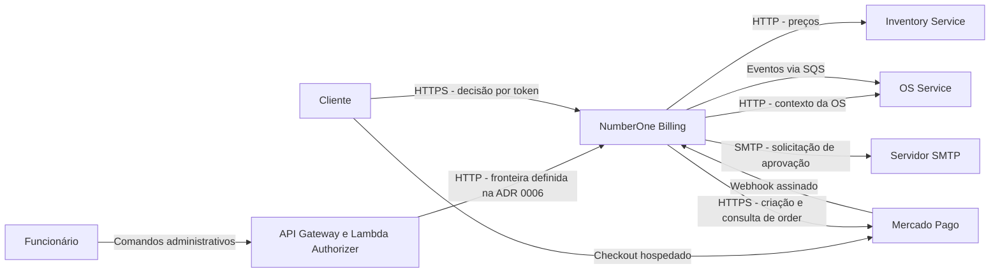
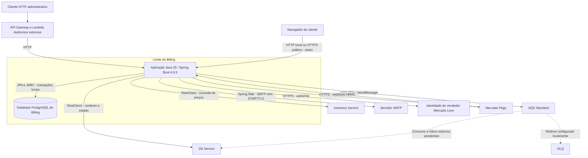
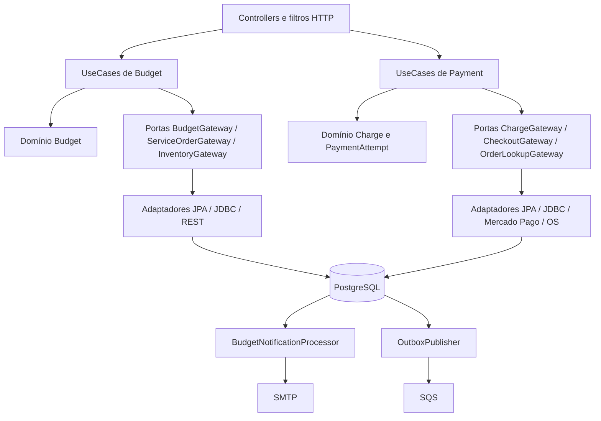

# Arquitetura do NumberOne Billing

O Billing é responsável por revisões de orçamento, decisões de aprovação, solicitações de e-mail, cobranças e tentativas de pagamento. OS Service mantém a ordem de serviço; Inventory Service fornece preços. O Billing conserva um snapshot comercial e publica fatos confirmados por uma Outbox PostgreSQL.

## Contexto — C4 nível 1

Gateway/Authorizer é a fronteira de autenticação administrativa decidida para a plataforma; seu provisionamento e isolamento não são comprovados por este repositório. As relações OS/Inventory representam os adaptadores implementados, exercitados com mocks. O consumo dos eventos na OS depende de implementação externa. Mercado Pago opera somente por habilitação explícita em `local`/`TEST`.

## Containers — C4 nível 2

Um container C4 representa uma aplicação ou armazenamento. Os workers executam dentro da aplicação Billing. O [Compose](../../docker-compose.yml) inicia PostgreSQL 17, LocalStack e dois servidores Mockoon; o Billing é iniciado no host. Não há manifesto de deployment EKS neste repositório. RDS é a decisão de destino da [ADR 0001](../adr/0001-billing-database.md), sem atestação de infraestrutura implantada.

## Componentes — C4 nível 3

As setas mostram a colaboração em execução; as interfaces das portas pertencem a `application`, e os adaptadores as implementam em `infrastructure`. O código se organiza primeiro por domínio (`budget`, `payment`), depois por `api`, `application`, `domain` e `infrastructure`. `domain` e `application` não dependem de Spring/JPA. A composição de beans e as transações ficam na infraestrutura. Mapeadores separam DTOs HTTP, agregados Java e entidades JPA.

Há acoplamento local explícito: `ChargeGatewayImpl` consulta `budget` via JDBC para validar o orçamento aprovado. Payment reutiliza o repositório/publicador de Outbox localizado no pacote de infraestrutura de Budget; `IntegrationEventOutboxEntry` está na infraestrutura compartilhada. Não há serviços separados para esses dois domínios.

## Consistência e limites de integração

| Limite | Garantia implementada |
| --- | --- |
| Budget | Contador e lock por OS, `@Version` JPA e validação de revisão vigente |
| Payment | Lock da raiz Charge, `@Version`, identidades únicas e uma tentativa bloqueante por cobrança |
| Commit local | Estado comercial e intenção de evento persistidos juntos; envio remoto ocorre depois |
| Checkout | Reserva permanente confirmada antes do POST; associação em outra transação |
| Notificação | Intenção durável separada da Outbox SQS; SMTP fora da transação |
| Distribuído | Sem transação distribuída, exactly-once, ordem global ou coordenador Saga implementado |

O Billing não consome SQS. Não há consumidor de `OSConcluida`, Inbox local ou compensação automática. Os TODOs de Saga apontam consumo externo da aprovação presencial, autenticação entre serviços, recuperação de checkout e tratamento de quitação histórica sem evento.

Veja [domínio](domain-model.md), [persistência](data-model.md), [fluxo de aprovação](../flows/budget-approval.md), [pagamento](../flows/payment.md), [Outbox](../flows/outbox.md) e [pendências](../technical-debt.md).
