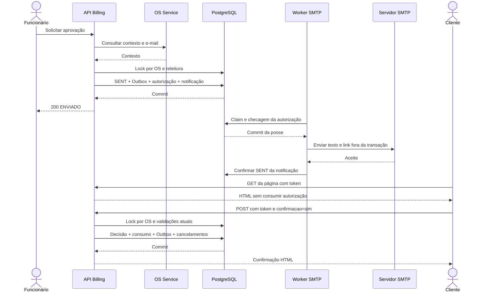

# Orçamento, aprovação e notificação

## Criação e revisão

`CreateBudgetUseCase` valida o valor manual antes de I/O, consulta contexto da OS e exige identidade correspondente e estado `IN_DIAGNOSIS` ou `REJECTED`. Com valor manual positivo, conserva esse valor e não consulta preços. Sem valor manual, consulta Inventory para os insumos dos itens elegíveis e soma serviços e insumos, sem substituir campos necessários ausentes por zero.

O snapshot conserva os itens recebidos. Apenas `CANCELLED` é excluído do cálculo e da consulta de preços; status ausente/desconhecido falha no cálculo automático. Lista vazia gera zero. Preços duplicados são recusados. Não há validação global de moeda em Budget nem validação de positividade de cada componente/quantidade. A precisão de centavos e seus limites estão no [modelo de domínio](../architecture/domain-model.md).

O gateway incrementa o contador por OS com UPSERT, verifica ausência de aprovação impeditiva e persiste novo `Budget` DRAFT no mesmo commit. Uma nova revisão possui outro UUID; não há edição de valor/composição por endpoint. Falha de criação reverte também o contador. Não se publica evento de DRAFT.

## Primeiro envio e decisão remota

O primeiro envio exige DRAFT elegível, OS ainda `IN_DIAGNOSIS`/`REJECTED` e e-mail não vazio. A consulta externa ocorre antes do lock e não fornece garantia contra alterações posteriores na OS. Valor, versão comercial e snapshot não são recalculados. `SENT` significa disponibilização comercial, sem provar aceite SMTP ou aplicação do evento na OS.

Na transação de envio, `BudgetGatewayImpl` bloqueia a linha do contador sem incrementá-lo, recarrega a entidade gerenciada, valida vigência e confirma `SENT`, `OrcamentoEnviado`, autorização e notificação PENDING. Ausência/falha de chave AES, URL ou preparo da notificação provoca rollback e 503. O worker desabilitado não dispensa chave/URL para agendar.

### Autorização

O token tem 32 bytes aleatórios, codificados em Base64 URL sem padding (43 caracteres). A autorização guarda somente SHA-256 hexadecimal; destinatário e link necessários ao envio ficam cifrados na notificação com AES-256-GCM, nonce de 12 bytes, tag de 128 bits e `authorizationId` como dado autenticado adicional. O formato cifrado tem byte de versão. A chave de 32 bytes vem externamente em Base64.

TTL padrão: 48h. Expirar o link não muda o estado do orçamento. O índice ativo exclui revogados/consumidos, mas não exclui por relógio. O uso valida criação inclusiva, expiração exclusiva, revogação e consumo com relógio PostgreSQL. Após obter o lock por OS, o POST relê autorização e orçamento; uma leitura GET anterior não autoriza a escrita.

A decisão pública exige SENT vigente e confirmação explícita. Aprovação é integral, com `approvalOrigin=REMOTE` e sem funcionário. Rejeição muda o estado e `updatedAt`, sem gravar origem de aprovação. Consumo da autorização, decisão, evento e cancelamento das pendências confirmam juntos. Duas abas disputam o mesmo lock: só uma decide. Replay de token consumido retorna conflito, sem repetir evento.

Os PATCHes administrativos legados também exigem SENT vigente, mas não usam token nem atribuem origem remota. Aprovação/rejeição revogam autorizações ainda não consumidas da OS e cancelam notificações PENDING na mesma transação. A autorização consumida pela decisão pública é preservada como consumida, sem revogação posterior.

### Thymeleaf e conteúdo do e-mail

- [decision.html](../../src/main/resources/templates/budget/decision.html): página pública com UUID, versão, valor, prazo UTC, composição opcional e dois formulários de decisão com confirmação.
- [decision-result.html](../../src/main/resources/templates/budget/decision-result.html): sucesso ou erro sem reexibir o token.
- [budget.css](../../src/main/resources/static/css/budget.css): recurso local das páginas; não contém token nem dados comerciais.
- `SmtpBudgetEmailSender` envia **texto simples** com `SimpleMailMessage`, assunto, valor, link e validade UTC. O e-mail não é renderizado por Thymeleaf.

Os templates escapam conteúdo variável e não carregam scripts/recursos externos. A credencial fica na query do link e em campo oculto do formulário. O filtro extrai os dados e os oculta do MVC, define no-store, no-referrer, nosniff, bloqueio de frames e CSP restritiva. A posse do token autoriza a decisão, sem sessão/JWT de cliente. Logs de infraestrutura e histórico do navegador exigem cuidados próprios. Não foi feita avaliação visual do e-mail.

## Aprovação presencial

`RegisterBudgetApprovalUseCase` obtém contexto de funcionário por `EmployeeIdentityGateway`. O header é auditoria, não autenticação. Para DRAFT, consulta OS e exige elegibilidade, sem exigir e-mail ou consultar preços. Para SENT, não consulta OS novamente.

| Caminho | Resultado confirmado |
| --- | --- |
| DRAFT presencial | DRAFT → SENT → APPROVED em memória, um flush, `sentAt` e `approvedAt`, origem IN_PERSON, funcionário e somente `OrcamentoAprovado` |
| SENT presencial | SENT → APPROVED, conserva `sentAt`, grava auditoria e `OrcamentoAprovado` |
| Decisão por e-mail | POST público consome autorização; aprovação registra REMOTE; exige SENT vigente |
| PATCH legado de aprovação | Aprovação de SENT vigente, sem atribuir origem; não equivale a auditoria presencial |

O estado SENT intermediário presencial não gera `OrcamentoEnviado`, autorização ou e-mail. Se existiam pendências de outra revisão, a decisão as cancela. O consumidor OS deve tratar `OrcamentoAprovado` sem envio anterior; esse contrato externo segue pendente.

## Reenvio

Somente SENT vigente admite reenvio. O UseCase consulta o e-mail atual, sem recalcular nem exigir o status técnico de criação da OS. Sob lock por OS, verifica intervalo mínimo de 30s, revoga links anteriores, cancela notificações PENDING e grava nova autorização/notificação. Falha reverte a substituição e conserva o link anterior.

O reenvio não muda Budget, `budgetVersion`, `row_version` ou `sentAt` e não gera novo evento. Não é idempotência: após o intervalo, outra chamada válida é outro envio. Criar apenas novo DRAFT preserva a autorização da revisão enviada; enviar revisão mais nova a invalida. `podeReenviar` no GET é informativo e não substitui essas validações.

## SMTP, concorrência e falhas

`BudgetNotificationProcessor` reivindica lote com `FOR UPDATE SKIP LOCKED`. A reivindicação incrementa tentativas, grava último horário e confirma uma posse antes do SMTP. Antes da entrega, `prepareDelivery` verifica novamente posse, autorização e revisão vigente em transação curta. Decifragem e SMTP ocorrem fora da transação.

| Estado da notificação | Significado e saída |
| --- | --- |
| PENDING | Disponível, em backoff ou com posse ativa |
| SENT | Aceite SMTP confirmado localmente; não comprova entrega/leitura |
| FAILED | Falha permanente ou tentativas esgotadas |
| CANCELLED | Autorização/revisão deixou de ser utilizável antes da conclusão local |

Falhas transitórias recebem backoff exponencial limitado. Conteúdo indisponível, autenticação SMTP, parse/preparo de mensagem são falhas permanentes. A categoria controlada é persistida sem resposta SMTP arbitrária. Claim abandonado pode ser retomado após expiração; se esgotou tentativas, encerra em FAILED. Conteúdo cifrado é apagado em todos os estados finais.

Confirmação/falha só pode escrever com token de posse atual e prazo válido. Aceite SMTP seguido de queda antes da confirmação pode causar e-mail duplicado. Revogação durante SMTP não interrompe o envio externo: um e-mail antigo pode chegar com link inválido. Posse expirada durante SMTP também pode permitir entrega concorrente. Não há entrega exatamente uma vez nem limite absoluto da conversa SMTP pelos timeouts de socket.

O histórico permanece. Não há reabertura automática de solicitação final; o funcionário solicita reenvio. Rotação de chave, retenção e parâmetros operacionais estão em [operação local](../operations/local-testing.md) e [débitos](../technical-debt.md). Testes relevantes: `BudgetPersistenceIT`, `BudgetPublicDecisionIT`, `BudgetNotificationIT` e testes HTTP Budget, em [src/test](../../src/test/java/br/com/fiap/numberone/billing/budget).
