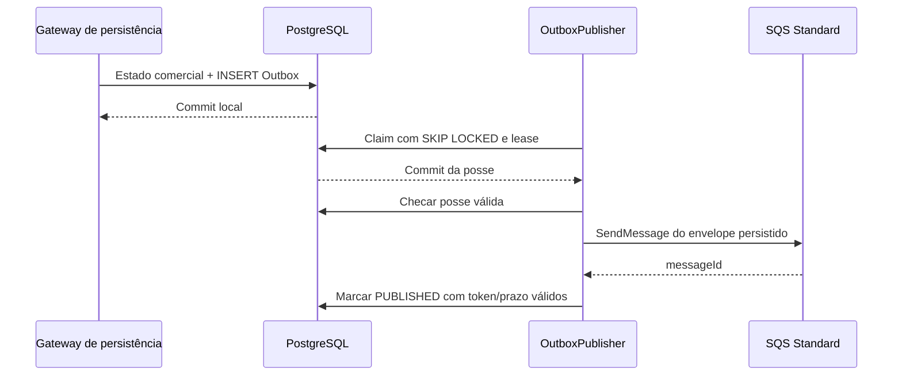

# Outbox e publicação SQS

## Persistência e entrega

Budget e Payment inserem o envelope completo em `integration_event_outbox` na mesma transação da transição comercial. `append` exige transação existente (`MANDATORY`). Não há envio ao SQS dentro dessa transação. O [contrato de eventos](../integrations/events.md) define os quatro fatos publicados e seus gatilhos.

O publicador envia `envelope::text` diretamente como corpo, sem reconstruir a partir de dados atuais. JSONB normaliza formatação/ordem de propriedades; não se promete igualdade byte a byte com a serialização anterior ao INSERT. `eventId`, versão, valores e instante comercial permanecem os mesmos nas tentativas.

## Claims e concorrência

`OutboxPublisher` executa com fixed delay quando habilitado. O repositório seleciona PENDING disponíveis por `next_attempt_at`, `created_at`, `event_id`, com `FOR UPDATE SKIP LOCKED`, lote limitado e relógio PostgreSQL. Cada claim incrementa tentativas e grava token/prazo, inclusive se o processo cair antes do envio. Outra réplica pula linhas bloqueadas ou com posse válida.

Há uma verificação de posse antes de publicar. Marcar publicação ou falha exige PENDING, token atual e lease ainda válido. Isso protege a confirmação local, não impede que uma posse expire durante HTTP. Pausa longa, aceite sem confirmação e retomada podem duplicar publicação.

A configuração exige `lease-duration > batch-size × api-call-timeout` (padrões: 60s > 10 × 5s). O SDK usa uma tentativa por chamada; retentativas são controladas pela Outbox. Não há renovação de lease durante envio.

## Estados e falhas

| Situação | Resultado |
| --- | --- |
| SQS aceita com messageId e confirmação local conclui | PUBLISHED e `published_at` preenchido |
| Timeout ou falha transitória | PENDING, categoria controlada, lease liberado e backoff limitado |
| Rejeição que exige intervenção ou orçamento esgotado | NEEDS_REVIEW |
| Processo cai com lease | Retomada após expiração se houver tentativas |
| Último claim é abandonado | NEEDS_REVIEW na recuperação, sem envio infinito |
| SQS aceita e banco falha na confirmação | Conserva posse; não repete imediatamente; retomada pode duplicar |
| Token já substituído ou prazo vencido | Escrita do worker antigo não confirma a posse atual |

Backoff: `min(initial-backoff × 2^(tentativa−1), max-backoff)`. Padrões: cinco claims, 5s inicial, 5m máximo, lote 10 e polling 1s. `last_error` guarda somente diagnóstico controlado, por exemplo categoria SQS e status HTTP, nunca envelope/credencial/resposta arbitrária.

NEEDS_REVIEW não é reativado automaticamente. Não há endpoint de reenvio, limpeza ou runbook auditável implementado para intervenção. A futura recuperação deve preservar o mesmo fato e sua identidade; não há instrução de UPDATE manual indiscriminado nesta documentação.

## Semântica e integração

A entrega é **pelo menos uma vez**, limitada pelas tentativas e pela necessidade de intervenção. Não há garantia de chegada de todo evento sem recuperação de falhas definitivas, exactly-once, ordem global ou atomicidade entre PostgreSQL e SQS. A ordenação de seleção do worker não impõe ordem de chegada ao consumidor.

`PUBLISHED` prova aceite SQS e confirmação local, não aplicação na OS. O consumidor externo precisa deduplicar `eventId` no mesmo commit de sua projeção, validar identidade/revisão e impedir regressão por mensagens atrasadas. Um ID com conteúdo divergente é conflito de contrato. Aprovação presencial pode não ter envio anterior; não presumir que `OrcamentoEnviado` sempre chegará.

Não há consumidor SQS no Billing. A DLQ trata mensagem aceita pela fila e não processada conforme redrive; falha de publicação anterior ao aceite fica no PostgreSQL. O ambiente LocalStack cria filas Standard `numberone-billing-events` e `numberone-billing-events-dlq`, visibilidade 30s e `maxReceiveCount=5`. São parâmetros locais; a topologia/IAM/retenção/alarmes AWS precisam de confirmação.

SMTP usa outra tabela/worker, com autorização revogável e conteúdo cifrado; não reutiliza a Outbox SQS. Veja [aprovação](budget-approval.md), [operação](../operations/local-testing.md), [ADR 0004](../adr/0004-transactional-outbox.md) e [ADR 0005](../adr/0005-message-broker-selection.md).
