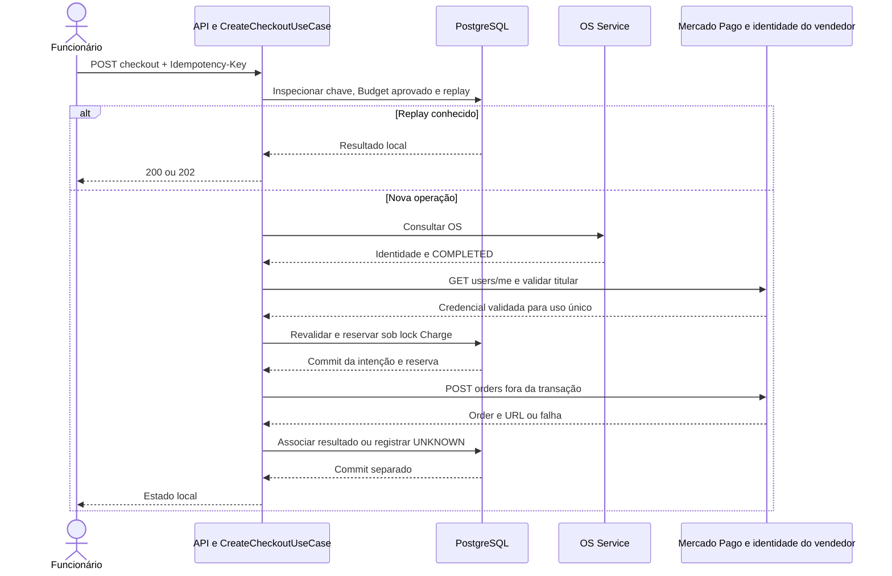

# Cobrança, checkout e confirmação financeira

## Início e reserva

O início é manual pelo endpoint administrativo de checkout. O request fornece somente OS e chave UUID; valor, moeda, orçamento, meio e status não vêm do consumidor.

1. `inspectCheckout` recusa transação chamadora e abre transação curta: verifica dono global da chave, exatamente um Budget APPROVED local e equivalência da cobrança existente. Replay válido retorna antes de consultar OS/vendedor. Alteração/inconsistência comercial local ainda pode impedir replay.
2. Sem replay, exige OS correspondente em `COMPLETED`, consultada por `ServiceOrderPaymentGateway`. A consulta usa `OS_SERVICE_BASE_URL`, sem autenticação entre serviços, e exige `cancellationInProgress=false` booleano.
3. `CheckoutGateway.validateSeller` consulta `/users/me`, fora de transação, e compara o titular com o vendedor de teste esperado, obtido independentemente no painel. Falha não cria cobrança/tentativa/reserva/UNKNOWN. O resultado é uma operação de criação de uso único com a credencial capturada na infraestrutura.
4. `prepareCheckout` usa `Propagation.NEVER` e `TransactionTemplate`: revalida os dados sob locks, lê valor aprovado sob `FOR SHARE`, cria/recupera Charge, usa `FOR UPDATE` na raiz e cria tentativa PENDING com reserva permanente. Somente tentativa nascida nessa invocação recebe `acquired=true`.
5. Somente quem adquiriu e confirmou a reserva faz POST externo. Concorrentes podem repetir consultas prévias, mas não ganham outra autorização de criação. A operação usa a mesma credencial validada; não repete GET de vendedor antes do POST.
6. Resposta é associada em outra transação. Criar/associar order não confirma pagamento. Consulta GET administrativa lê exclusivamente dados locais e a tentativa mais recente por `createdAt`, com desempate por UUID.

Falha no commit da preparação impede POST. PENDING legado sem reserva também não autoriza POST. A reserva não é renovada, assumida, expirada ou liberada por replay/relógio. Não há scheduler de recuperação.

## Idempotência e resultados desconhecidos

Uma chave UUID identifica globalmente uma tentativa. Repetir a mesma chave recupera seu estado, inclusive terminal, sem novo POST. Reusar em outra OS ou com referência comercial incompatível é conflito. Nova chave é bloqueada quando há PENDING, UNKNOWN ou PAID; FAILED/EXPIRED confirmados permitem outra solicitação manual, mas o webhook atual não produz esses estados.

| Falha/janela | Comportamento |
| --- | --- |
| OS/vendedor indisponível antes da reserva | Erro tipado da API; sem nova persistência financeira |
| Queda depois do commit e antes/durante POST | PENDING com reserva, sem autorização para repetir; não se distingue ausência de chamada de aceite remoto |
| Falha tipada de criação, inclusive recusa HTTP | Tenta gravar UNKNOWN e retorna estado aceito 202; não equivale a falha financeira confirmada |
| Falha inesperada ou associação não persistida | Tenta UNKNOWN e lança erro recuperável com IDs, HTTP 503 |
| Falha também ao gravar UNKNOWN | Reserva original pode continuar PENDING; preserva causas técnicas, sem novo POST |
| Sucesso remoto sem associação local | Exige reconciliação pela identidade original; webhook sem vínculo não associa arbitrariamente |
| Tentativa terminal com resultado posterior contraditório | Não reabre/reescreve a quitação; exige intervenção |

UNKNOWN pode ter URL já conhecida; o status continua indicando incerteza. HTTP 202 não promete um worker ou conclusão automática. Não trocar chave para contornar pendência. [Débitos de recuperação](../technical-debt.md#recuperação-financeira-e-recebimento-durável) descrevem os limites.

## Webhook e consulta

O [contrato Mercado Pago](../integrations/mercado-pago.md) descreve HMAC, envelope e guardas TEST. Depois da autenticação e validação do corpo, `ObserveOrderWebhookUseCase` localiza a tentativa por `providerOrderId` original.

Sem vínculo local, retorna `UNKNOWN_ORDER`: o controller responde **503 vazio**, sem consultar provedor/criar dados ou persistir notificação. A reentrega depois da associação pode confirmar. Isso mitiga a corrida com o POST de criação, mas não fornece recebimento durável, garantia de reentrega ou descoberta de order perdida.

Com vínculo, a consulta externa verifica novamente `/users/me` e usa a credencial validada para `GET /v1/orders/{id}`, fora da transação. `OrderPaymentEvidence` compara order, tentativa, referência externa, moeda, valor e IDs financeiros antes de classificar a observação.

| Estado observado da order | Situação de aplicação | Efeito automático local |
| --- | --- | --- |
| created / processing / action_required | PENDING | Nenhuma transição financeira |
| failed | REJECTED | Não grava FAILED |
| canceled | CANCELED | Não cancela/libera reserva |
| refunded | REFUNDED | Não estorna nem desfaz PAID |
| processed com evidência integral | APPROVED | Revalidação e possível quitação |
| processed insuficiente ou estado desconhecido | INDETERMINATE | Nenhuma transição financeira |
| Sem order associada | UNKNOWN_ORDER | 503 vazio; aguarda reentrega |

Identidade, referência, moeda ou valor comercial divergentes são resposta inválida (502), antes de classificar situação. Falta/incoerência dos totais pagos em uma resposta estruturalmente válida não aprova e pode resultar em INDETERMINATE. HMAC válido e HTTP 200 não significam necessariamente PAID.

## Evidência necessária à quitação

Todas as condições são cumulativas:

- Order corresponde ao ID consultado e à tentativa local; `external_reference` é `attemptId`, moeda BRL e `total_amount = Charge.amount`.
- Order está `processed`/`accredited`, com exatamente uma transação financeira; sem entradas de refunds/chargebacks.
- Transação tem ID válido, `processed`/`accredited` e `payment.amount = order.total_amount`.
- `paid_amount` cobre `payment.amount`, `total_paid_amount` cobre `total_amount` e ambos os totais pagos são iguais entre si.
- Valores financeiros relevantes são positivos e têm escala de até duas casas; a consulta possui validação de formato própria, sem arredondamento.
- IDs já associados permanecem compatíveis. Duas transações não são somadas para escolher uma identidade financeira arbitrária.

A [fixture de parcelamento](../../src/test/resources/payment/checkout-pro-paid-installments.json) demonstra principal `10.00`, transação `10` e totais pagos `10.96`: com as demais condições válidas, quita o principal. O excedente não é classificado como juros/taxa; campos de parcelas não são persistidos automaticamente. `capture_mode` da fixture não configura comportamento do Billing: não há operação de captura implementada.

## Confirmação, Outbox e repetição

`ConfirmPaymentUseCase` encaminha somente APPROVED. `ChargeGatewayImpl.confirmPayment` adquire FOR UPDATE na raiz, relê agregado e reutiliza `OrderPaymentEvidence.requireApproved` sob lock. O domínio aplica a transição e protege a identidade financeira. Na primeira mudança OPEN → PAID, atualiza raiz/tentativa e insere `PagamentoConfirmado` na mesma transação PostgreSQL.

Falha de flush, INSERT de Outbox ou commit reverte tudo; `PAYMENT_CONFIRMED` só ocorre após commit. O acknowledgment 200 do webhook ocorre depois dessa confirmação quando há quitação. Replay equivalente ou confirmação concorrente conserva datas, versão e evento original. Evento atrasado não aprovado não regride PAID. Evidência conflitante falha; não substitui IDs.

`paymentId = chargeId` e `paymentVersion = 1` representam a primeira quitação comercial, sem relação com `row_version`. Há índice único por cobrança/tipo. PAID histórico sem evento não recebe backfill por migration/replay. Publicação é posterior e duplicável; [Outbox](outbox.md) não garante aplicação na OS.

Implementação disponível: reserva, criação/consulta TEST, assinatura, evidência, confirmação e Outbox. Integrações automatizadas usam HTTP simulado e PostgreSQL/Testcontainers. Há registro histórico de teste local bem-sucedido, sem evidência reproduzível suficiente da jornada integrada completa neste repositório. Contratos OS/Inventory, consumidor OS, recuperação e operação fora de local permanecem pendentes; não há autorização técnica de produção apenas por usar credencial com prefixo TEST.

Evidências: `CreateCheckoutIT`, `VerifiedCheckoutIT`, `PaymentConfirmationIT`, `OrderWebhookObservationIT` (inclui webhook anterior ao vínculo e reentrega) e `OrderPaymentEvidenceTest`, em [testes Payment](../../src/test/java/br/com/fiap/numberone/billing/payment).
